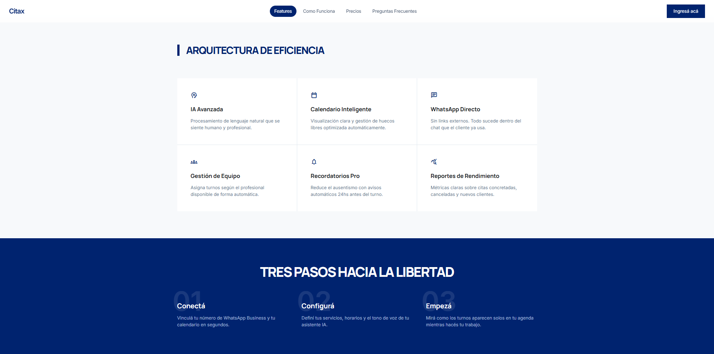

  <strong>English</strong> · <a href="README.es.md">Español</a>

  

<h1 align="center">Hi, I'm Nicolás Triberti</h1>

  Full Stack Developer from Argentina. I build backends, cloud infrastructure and AI-powered automations that run in production, not just in demos. 
  2+ years of hands-on experience · Advanced Systems Programming student.

  

  
  
  

  

## What I do

<table>
  <tr>
    <td width="33%" valign="top">
      <b>Backend</b> 
      APIs built to last: clear contracts, solid data models and integrations with third-party services.
    </td>
    <td width="33%" valign="top">
      <b>Cloud</b> 
      Reliable, containerized deployments on AWS, Oracle OCI, Google Cloud, Vultr and Cloudflare.
    </td>
    <td width="33%" valign="top">
      <b>Automation</b> 
      Agentic workflows that take repetitive business tasks off people's plates.
    </td>
  </tr>
</table>

## Featured project

### [Citax](https://www.citax.com.ar/) — appointments on autopilot via WhatsApp

A SaaS platform that lets businesses manage appointments straight from WhatsApp. I built and integrated its API, automated processes and AI services, all deployed with Docker.

> **1,000+ appointments** handled autonomously by its AI agents.

- **API & integrations** — Node.js / Express backend connected to the WhatsApp Business API.
- **AI agents** — conversational flows built with LangGraph and LangChain.
- **Data** — MySQL / TiDB as the source of truth for schedules and bookings.
- **Delivery** — containerized deployments with Docker.

  <code>Node.js</code> <code>Express</code> <code>MySQL / TiDB</code> <code>WhatsApp Business API</code> <code>LangGraph</code> <code>LangChain</code> <code>React</code> <code>Docker</code>

<table>
  <tr>
    <td width="50%"></td>
    <td width="50%"></td>
  </tr>
</table>

## Tech stack

<table>
  <tr>
    <td><b>Backend & data</b></td>
    <td>TypeScript · JavaScript · Python · Rust · Java Spring · REST APIs · Prisma · PostgreSQL · MySQL · TiDB · Cloudflare D1</td>
  </tr>
  <tr>
    <td><b>Cloud & infrastructure</b></td>
    <td>Docker · Linux · AWS EC2 / S3 · Vultr Cloud Compute · Oracle OCI · Google Compute Engine · Cloudflare Workers / R2</td>
  </tr>
  <tr>
    <td><b>DevOps & quality</b></td>
    <td>Git · GitHub Actions · CI/CD · Testing · Linting · Observability</td>
  </tr>
  <tr>
    <td><b>Automation & AI</b></td>
    <td>WhatsApp APIs · Cloud & embedded LLMs · LangGraph · LangChain · Webhooks</td>
  </tr>
  <tr>
    <td><b>Frontend</b></td>
    <td>React · React Native · Vite · Tailwind CSS · GSAP</td>
  </tr>
  <tr>
    <td><b>Integrations</b></td>
    <td>Mercado Pago · Gmail · Google Earth</td>
  </tr>
</table>

---

  <i>From the first endpoint to the last deploy — complete solutions for real-world use.</i>  
  

