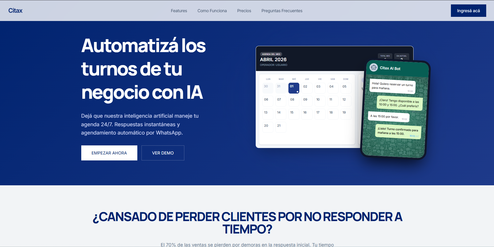
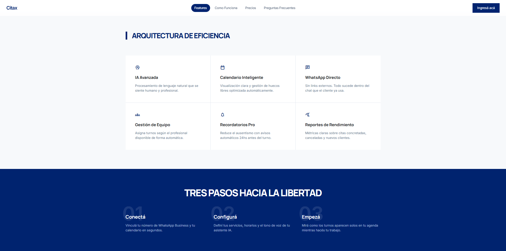

  <a href="README.md">English</a> · <strong>Español</strong>

  

<h1 align="center">Hola, soy Nicolás Triberti</h1>

  Desarrollador Full Stack de Argentina. Construyo backends, infraestructura cloud y automatizaciones con IA que funcionan en producción, no solo en demos. 
  Más de 2 años de experiencia práctica · Estudiante avanzado de Programación Universitaria de Sistemas.

  

  
  
  

  

## Qué hago

<table>
  <tr>
    <td width="33%" valign="top">
      <b>Backend</b> 
      APIs pensadas para durar: contratos claros, modelos de datos sólidos e integraciones con servicios externos.
    </td>
    <td width="33%" valign="top">
      <b>Cloud</b> 
      Despliegues confiables y containerizados en AWS, Oracle OCI, Google Cloud, Vultr y Cloudflare.
    </td>
    <td width="33%" valign="top">
      <b>Automatización</b> 
      Flujos agénticos que liberan a las personas de las tareas repetitivas del negocio.
    </td>
  </tr>
</table>

## Proyecto destacado

### [Citax](https://www.citax.com.ar/) — turnos en piloto automático por WhatsApp

SaaS que permite a los negocios gestionar sus turnos directamente desde WhatsApp. Desarrollé e integré su API, los procesos automatizados y los servicios de IA, todo desplegado con Docker.

> **Más de 1.000 turnos** gestionados de forma autónoma por sus agentes de IA.

- **API e integraciones** — backend en Node.js / Express conectado a la WhatsApp Business API.
- **Agentes de IA** — flujos conversacionales construidos con LangGraph y LangChain.
- **Datos** — MySQL / TiDB como fuente de verdad de agendas y reservas.
- **Entrega** — despliegues containerizados con Docker.

  <code>Node.js</code> <code>Express</code> <code>MySQL / TiDB</code> <code>WhatsApp Business API</code> <code>LangGraph</code> <code>LangChain</code> <code>React</code> <code>Docker</code>

<table>
  <tr>
    <td width="50%"></td>
    <td width="50%"></td>
  </tr>
</table>

## Tecnologías

<table>
  <tr>
    <td><b>Backend y datos</b></td>
    <td>TypeScript · JavaScript · Python · Rust · Java Spring · APIs REST · Prisma · PostgreSQL · MySQL · TiDB · Cloudflare D1</td>
  </tr>
  <tr>
    <td><b>Cloud e infraestructura</b></td>
    <td>Docker · Linux · AWS EC2 / S3 · Vultr Cloud Compute · Oracle OCI · Google Compute Engine · Cloudflare Workers / R2</td>
  </tr>
  <tr>
    <td><b>DevOps y calidad</b></td>
    <td>Git · GitHub Actions · CI/CD · Testing · Linting · Observabilidad</td>
  </tr>
  <tr>
    <td><b>Automatización e IA</b></td>
    <td>WhatsApp APIs · LLMs cloud y embebidos · LangGraph · LangChain · Webhooks</td>
  </tr>
  <tr>
    <td><b>Frontend</b></td>
    <td>React · React Native · Vite · Tailwind CSS · GSAP</td>
  </tr>
  <tr>
    <td><b>Integraciones</b></td>
    <td>Mercado Pago · Gmail · Google Earth</td>
  </tr>
</table>

---

  <i>Del primer endpoint al último deploy: soluciones completas para entornos reales.</i>  
  

